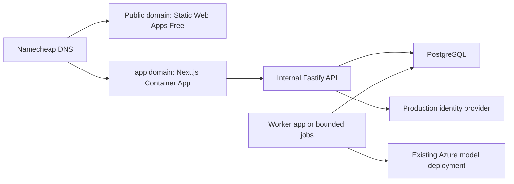

# Rooted on Azure: low-cost deployment to a Namecheap domain

Research date: **October 25, 2026**. Scope: a reviewable deployment plan, not deployment execution. `yourdomain.com` is a placeholder; the purchased domain, Azure region, subscription offer and acceptable monthly budget have not been supplied.

For the focused follow-up, see the [Option B resource documents](Option%20B/README.md): database alternatives, each resource's function and charges, and cost-minimization scenarios.

## Can I use a Storage Account and Azure Static Web Apps?

**Yes, Static Web Apps can be part of the solution. For the public introduction alone, Static Web Apps Free can be sufficient without a separate Storage Account.** It includes static asset hosting, a custom domain and managed HTTPS. Its Free plan is positioned for hobby/personal projects and has no SLA; an early preview is different from committing to production service levels. [Microsoft pricing](https://azure.microsoft.com/en-us/pricing/details/app-service/static/).

**Storage + Static Web Apps alone does not run the complete current Rooted application.** The saved studies, accounts, comments, reactions, co-writer and scheduled work depend on server code and PostgreSQL. Adding Blob Storage does not supply those capabilities.

There are three distinct Azure products/behaviors to separate:

| Option | What it provides | Fit for Rooted |
|---|---|---|
| Storage Account static website | Public HTML/CSS/JavaScript and files | Public brochure/sample pages only; storage transactions/capacity still have charges |
| Static Web Apps, static deployment | Static web hosting plus optional managed HTTP Functions APIs | Strong candidate for the public site; a fully static version of the app needs substantial adaptation |
| Static Web Apps, hybrid Next.js preview | Dynamic Next.js rendering as well as static pages | Possible frontend candidate; still needs Rooted's backend/database/worker and a compatibility proof |

Azure documents both [static and hybrid Next.js models](https://learn.microsoft.com/en-us/azure/static-web-apps/nextjs). The hybrid preview is available with a managed rendering backend, including on Free, but Microsoft lists preview limitations including linked API integrations and a 250 MB hybrid-app size limit. There is no verified deployment of Rooted's **Next.js 16.4.2 / Node 24** combination in this research. [Hybrid deployment documentation](https://learn.microsoft.com/en-us/azure/static-web-apps/deploy-nextjs-hybrid).

A Storage static-website endpoint serves files anonymously and does not supply application authentication. Custom-domain HTTPS requires an additional supported edge/proxy solution; its built-in endpoint's HTTPS does not automatically secure your own domain. This makes Storage alone less attractive for this particular custom-domain preview. [Storage static websites](https://learn.microsoft.com/en-us/azure/storage/blobs/storage-blob-static-website).

## What the current code actually needs

This table comes from repository inspection, rather than assuming every Next.js project needs the same resources.

| Current behavior | Repository evidence | Deployment consequence |
|---|---|---|
| Next.js frontend with dynamic member rendering | [Member server](../../frontend/lib/member-server.ts), [study route](../../frontend/app/c/%5Bslug%5D/studies/%5Bid%5D/page.tsx) | Server-side session/cookie reads and private content cannot be exported as public HTML |
| Fastify API and same-origin browser proxy | [App](../../backend/src/app.ts), [Next configuration](../../frontend/next.config.ts) | Needs Node hosting or an explicitly built/tested Functions adapter; uploading this server to SWA's API folder is insufficient |
| PostgreSQL transactions, forced RLS and named restricted runtime role | [Database](../../backend/src/infrastructure/database.ts), [migrations](../../backend/src/infrastructure/migrate.ts) | Blob, Table Storage, Cosmos DB and Azure SQL are not drop-in replacements |
| Continuous worker, polling every second | [Worker](../../backend/src/workers/worker.ts) | Needs a running process, or a new finite worker entry point and a real trigger |
| Production OIDC and MFA validation | [Auth configuration](../../backend/src/infrastructure/config.ts), [auth routes](../../backend/src/auth/routes.ts) | The local fictional identity issuer is not a public sign-in system; provider/token compatibility needs testing |
| Logos and reviewed source text already persisted in PostgreSQL | [Theme upload](../../backend/src/api/theme-routes.ts), [provider routes](../../backend/src/api/provider-routes.ts) | Blob Storage is not an immediate prerequisite merely to preserve current logos/text |
| Browser read-aloud for received studies | [Listening component](../../frontend/components/study-audio.tsx) | No Azure Speech resource is required by the current feature |

The frontend currently starts on `127.0.0.1:3000`, and the API also binds loopback. Container deployment must change service bindings to `0.0.0.0` and honor the configured ingress ports. Do not run the local development bootstrap in production: it starts a fictional issuer and can seed demo data.

## Deployment choices

**Monthly prices for every option:** [side-by-side costs and component breakdown](option-cost-comparison.md). The budgets below are low-usage infrastructure planning allowances in USD, excluding AI, taxes, domain renewal and separately selected services; code changes and quota conditions still apply.

| Path | Monthly infrastructure budget | Resources | Expected outcome | Engineering work |
|---|---:|---|---|---|
| **A — Free public preview** | **$0** within quotas | SWA Free; Namecheap DNS; source/deployment pipeline | Public marketing, AI illustrations and fictional sample on your domain | Extract a static public build and revise links; no functioning private workspace |
| **B — Working small pilot, recommended starting point** | **$35–$50** | Container Apps environment; frontend, API and worker apps; PostgreSQL Flexible Server; production identity; image registry | Current product with fewest architectural changes | Container packaging, production identity/database validation, configuration and deployment verification |
| **C — Lower idle cost after engineering changes** | **$20–$30** | Path B, replacing the continuous worker with bounded scheduled/on-demand Container Apps Jobs | Working application with lower background idle usage | Finite worker, trigger integration, latency/recovery tests; not just a scaling setting |
| **D — SWA frontend plus application services** | **$35–$50 Free frontend; $45–$60 Standard frontend** | SWA static or hybrid; Node API runtime; PostgreSQL; continuous worker in this price example; production identity | Keeps SWA in the full solution | Preview/runtime/proxy proof or static-client rewrite; extra platform boundary |
| **E — SWA + Functions + Storage + PostgreSQL** | **$20–$30 Free frontend; $30–$40 Standard frontend** | SWA; Functions Flex On Demand; host storage; PostgreSQL; identity; finite timer/job processing | Feasible serverless redesign | Adapt Fastify/session routes, SSR or client rendering, durable orchestration, timeouts and tenant security |

Path B does not require SWA as well. For a split site, put the public introduction on SWA at `yourdomain.com` and the working application at `app.yourdomain.com`; keep the app's authentication/API requests on the application origin.

The proposed split deployment looks like this; the right-hand application services are unnecessary for a brochure-only preview:

For Path D, SWA **managed Functions APIs** exist on all plans, but **bring-your-own linked APIs require Standard**. The documented API gateway limit is 45 seconds, close to the current co-writer request timeout; move slow operations behind durable jobs and short status requests if using that gateway. A Free static client can call an independently hosted public API, but that is a cross-origin design requiring new cookie, callback and CORS work. It does not provide the existing same-origin proxy automatically. [API support and constraints](https://learn.microsoft.com/en-us/azure/static-web-apps/apis-overview).

SWA platform authentication/custom roles do not automatically replace Rooted's church memberships, capabilities, CSRF or forced-RLS checks. Avoid changing identity or database security merely to fit a free tier.

## Steps for Path A: public pages at approximately $0 hosting

1. **Define the preview scope.** Include the approved homepage, benefits, AI examples, process, research attribution and fictional devotional. Show an honest preview/coming-soon explanation for church registration until the application is hosted. Do not publish the research prototype's fake email verification forms as account signup.
2. **Prepare a separate static build.** Reuse the approved public React components/assets in a public-only project or dedicated export target. Do not set `output: 'export'` on the entire existing app: its private dynamic routes/cookie reads and rewrites require runtime behavior. If Next.js is used, follow its current static-export guidance and Microsoft's [static deployment tutorial](https://learn.microsoft.com/en-us/azure/static-web-apps/deploy-nextjs-static-export).
3. **Prepare source and deployment.** Use a repository or supported deployment artifact. Include only deployable code/assets; exclude `.env`, `Secrets`, local databases, private studies, logs, screenshots containing real data, and live verification ledgers. No Azure credentials belong in the exported JavaScript.
4. **Create a resource group**, for example `rg-rooted-preview`, and an **Azure Static Web App → Free**. Use a custom/static build configuration, leave API location empty and select the actual generated output directory. Do not automatically select a hybrid preset when deploying the public-only export.
5. **Deploy and verify the generated `*.azurestaticapps.net` URL first.** Check navigation, mobile layout, keyboard controls, sample content and disabled/unavailable account actions. SWA includes the files needed for this stage; create no Storage Account just to duplicate its hosting.
6. **Add `www.yourdomain.com`** in SWA → Custom domains → domain on another DNS provider. Create the CNAME at Namecheap pointing `www` to the generated SWA hostname, without `https://` or a path. Use the portal's ownership-validation instructions if it requests a TXT record. [External-domain procedure](https://learn.microsoft.com/en-us/azure/static-web-apps/custom-domain-external).
7. **Add the apex `yourdomain.com`.** Generate the ownership TXT value in SWA and create `TXT @` with that value. With Namecheap DNS supporting ALIAS, create `ALIAS @` to the SWA hostname. Remove only conflicting website records for that host; keep mail records. Do not use the Container Apps A/asuid recipe for this SWA deployment. [Azure apex procedure](https://learn.microsoft.com/en-us/azure/static-web-apps/apex-domain-external), [Namecheap ALIAS instructions](https://www.namecheap.com/support/knowledgebase/article.aspx/10128/2237/how-to-create-an-alias-record/).
8. **Verify HTTPS on both names** and configure a default/canonical domain. Validate certificate issuance, redirects, asset loading and search metadata after DNS propagation. Use the values Azure actually supplies; no production IP or verification code has been generated in this research.
9. **Monitor quotas and deployment usage.** The cited Free quota includes 100 GB monthly bandwidth, 250 MB per environment, 500 MB across environments and two custom domains. Free service can stop serving when quotas are exceeded. GitHub build/artifact usage has separate limits. This is a $0 hosting target within limits, excluding domain renewal and any later services. [SWA quotas](https://learn.microsoft.com/en-us/azure/static-web-apps/quotas).

### Example DNS records: SWA public preview

| Type | Namecheap host | Value |
|---|---|---|
| CNAME | `www` | `<generated-name>.azurestaticapps.net` |
| TXT | `@` | `<SWA-generated apex ownership token>` |
| ALIAS | `@` | `<generated-name>.azurestaticapps.net` |

These are templates, not records ready to submit. If your authoritative DNS is hosted elsewhere, configure it there. Buying a domain at Namecheap does not prove Namecheap currently hosts its DNS. A standard CNAME at the apex is not the same thing as an ALIAS. An Azure-provided stable A record is an alternative when ALIAS is unavailable, with the distribution tradeoff documented by Microsoft.

## Steps for Path B: the working application

1. **Confirm the cost envelope.** Choose region, subscription, users/traffic and initial storage. Check whether the subscription still qualifies for the PostgreSQL introductory offer. The [cost model](cost-model.md) uses East US, USD, 730 hours and a tiny single-region pilot; it is not a production SLA or account quote.
2. **Create the deployment resources.** One resource group; one Consumption Container Apps environment; frontend app with public HTTP ingress; API app with internal HTTP ingress; worker app with no ingress. Choose a registry: Azure Container Registry is convenient but separately billed, while an existing suitable registry can avoid that new Azure resource. Set deliberate replica caps rather than leaving unlimited scale assumptions.
3. **Package the processes.** Add reproducible container builds with pinned supported Node runtime and local static assets. Use production commands, non-loopback bindings, health checks, graceful shutdown and secret injection. For a first pilot, frontend/API may scale from zero; set the continuous worker to one minimum replica. No-ingress apps do not wake automatically without a trigger. [Container Apps scaling](https://learn.microsoft.com/en-us/azure/container-apps/scale-app).
4. **Provision PostgreSQL Flexible Server.** Start with a supported Burstable SKU and modest storage if capacity testing permits. Use TLS and restricted network access. Run migrations with a distinct authorized migration identity, and API/worker with the nonowner `gather_runtime` role. Prove Azure's managed-admin privileges support the migration's role/grant/function requirements and forced RLS; do not bypass those checks. Import only the data explicitly selected for the pilot, with a backup and restore test.
5. **Configure real customer identity.** Microsoft Entra External ID is a candidate. Create the external tenant, confidential app registration, signup/sign-in flow and exact callback URL. Test issuer/audience, PKCE, nonce, sessions, logout and MFA claims: Rooted currently requires an `amr` claim containing `mfa` in production, and a configured provider may express assurance differently. Any mapping change needs evidence and an explicit security design, not removal of MFA to make login pass. [External ID overview](https://learn.microsoft.com/en-us/entra/external-id/customers/overview-customers-ciam).
6. **Configure server settings and secrets.** Set `NODE_ENV=production`, `APP_ORIGIN=https://app.yourdomain.com`, real OIDC settings and `OIDC_CALLBACK_URL=https://app.yourdomain.com/api/v1/auth/callback`. Set `BACKEND_URL` to the internal API address at frontend build time and runtime because Next rewrites are built from it. Set `ROOTED_PUBLIC_ORIGIN` to the chosen public HTTPS marketing origin and rebuild metadata. Inject database/model/encryption secrets only where required. Container Apps secrets suffice initially; Key Vault integration is an optional improvement. Preserve existing AI budgets and disable development personas/verification fixtures.
7. **Bind `app.yourdomain.com` to the frontend.** Add a Container Apps custom domain and managed certificate. The usual subdomain records are `CNAME app → <frontend>.azurecontainerapps.io` and `TXT asuid.app → <verification code>`. If hosting the apex directly on Container Apps instead of SWA, its recipe is `A @ → environment IP` plus `TXT asuid`. Do not mix these with SWA's apex token/ALIAS procedure. Follow certificate accessibility/CAA requirements. [Container Apps custom domains](https://learn.microsoft.com/en-us/azure/container-apps/custom-domains-managed-certificates).
8. **Connect the public site's buttons.** For a split deployment, link real signup/sign-in/member journeys to the `app` origin. Keep OIDC cookies, CSRF, member content and API proxy behavior on that origin. Keep server state out of the static marketing build. Do not expose an internal API address to browser bundles.
9. **Verify the complete pilot.** Real identity → create church → role-aware team setup → co-writer clarification/each-day confirmation → saved draft → human approval/publication → member reading/audio/reactions/moderated comments. Test wrong church/identity, cold start, duplicate commands, restart during generation, uncertain provider outcome, timeout and recovery. An empty homepage responding HTTP 200 is not full deployment acceptance.
10. **Enable operations.** Configure retained backups, small logging retention, health/error alerts and Cost Management notifications. Keep one service region initially where appropriate; avoid adding paid edge/network appliances without a demonstrated need. Retain a rollback revision, database backup and DNS record snapshot. Public rollout and actual resource creation require a separate execution instruction.

## How Path C lowers worker cost

The current worker loops forever. Deploying that file as a scheduled job would make a never-ending job; setting its replicas to zero would stop drafts/publication processing.

Add a separate **finite** entry point that performs bounded due-work/claim processing and exits, closes the database pool and handles shutdown. Reuse leases, idempotency, tenant checks, confirmations and uncertain-submission accounting. Start drafting jobs after an authorized confirmation; use a scheduled catch-up job for due publication/recovery. Limit overlapping executions and retries so a host retry cannot blindly repeat paid model inference.

Container Apps Jobs support schedules with UTC cron expressions. Choose and test a 1–5 minute catch-up interval; startup plus interval adds latency. Manual/on-demand kickoff requires authenticated application integration and a narrowly scoped Azure identity, which is not implemented today. Test source/cancellation checks and time-bound publication behavior before replacing the always-on worker. [Jobs documentation](https://learn.microsoft.com/en-us/azure/container-apps/jobs).

A standalone Azure Functions timer is another option, but Functions host storage is then part of that architecture. SWA's managed HTTP API feature is not an unchanged host for the current endless worker loop. A Storage Account can therefore be useful for Functions or later media uploads; it is not a substitute for PostgreSQL or a consequence of merely choosing SWA. [Functions storage requirements](https://learn.microsoft.com/en-us/azure/azure-functions/storage-considerations).

## Additional resources: required versus optional

| Resource | Public preview | Full pilot |
|---|---|---|
| Namecheap DNS | Reuse | Reuse |
| SWA Free + managed certificate | Recommended | Optional public-site front door; not mandatory for the application |
| Extra Storage Account | Not needed | Optional for new media/backups or required by a selected Functions architecture |
| Node/server compute | Not needed for exported public pages | Required for current frontend/API behavior |
| PostgreSQL | Not needed | Required unless the application is redesigned |
| Worker compute or job trigger | Not needed | Required for AI drafting and scheduled work |
| Production identity | Not needed for brochure | Required for accounts/private participation |
| Existing Azure model deployment | Not called by brochure examples | Reuse; inference remains metered |
| Azure Key Vault | Not needed | Optional initially; built-in secret storage is an alternative |
| Azure Container Registry | Not needed | Optional choice of image registry, not the only possible registry |
| Azure DNS, Front Door/CDN, API Management, Redis, Service Bus, AI Search, Kubernetes | Not needed | No demonstrated initial requirement in this deployment plan |

The core pilot can start without a separate object store because current logo bytes and reviewed source text are in PostgreSQL. Future large files should have an explicit private-object-storage design. Never rely on a container's temporary filesystem to retain uploads across restarts.

## Decision to make before execution

Choose **A** to put the approved public introduction on the purchased domain at a $0 hosting target now, or **B** for a real account-based pilot with a modest ongoing bill. **C** is a cost optimization after its worker changes are built and tested. **D/E** remain valid alternatives if using SWA for the full frontend is a priority, with explicit compatibility/refactor work.

Open inputs: purchased domain, authoritative DNS host, Azure subscription/free-offer eligibility, region, existing image registry/source hosting, initial church/user count, acceptable worker delay, identity/MFA choice and monthly spending target. The recommendations and unit rates here do not claim those account-specific decisions are already configured.
