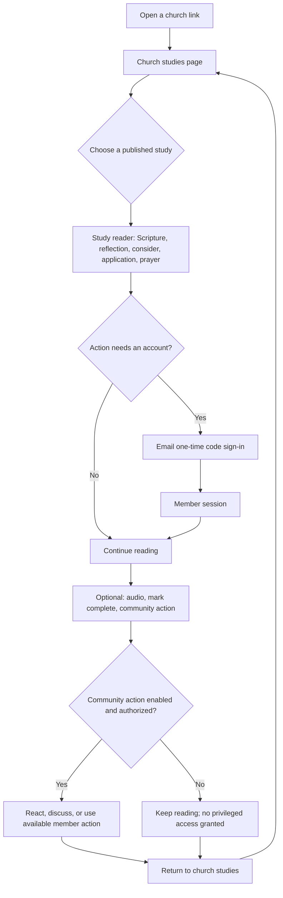
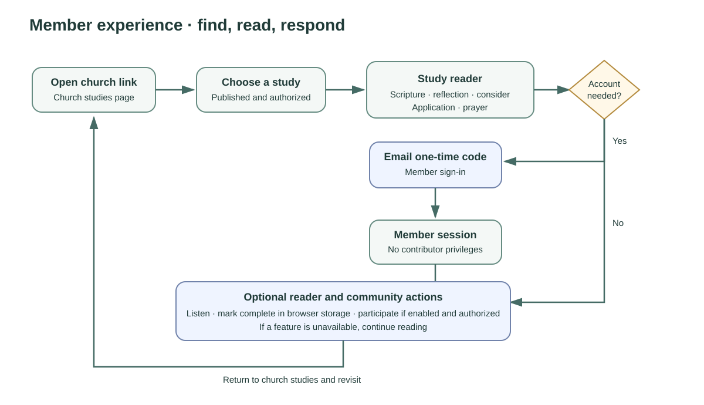

# Mental model 1 — member experience

The member-facing experience starts at a church's public page. A visitor can see the church's published studies, open an authorized study, and read its Scripture, reflection, questions, application, and prayer. Sign-in is used where the church's access policy or a participation action requires it. Ordinary member authentication uses email one-time code; reading access does not require contributor MFA.

The reader can listen to the study, follow its sections, mark it complete in browser storage, and use available community actions. Browser storage is optional, so reading remains possible if completion tracking cannot be saved. Community participation is governed by the church's configured features and the member's authorization. Public access is a church policy choice; a members-only publication remains protected.

## Journey

## Access boundaries

- The session's church list and current membership determine which church content and actions are available.
- Member email-code sign-in is a separate flow from contributor sign-in. A member session cannot invoke privileged APIs simply because the same person has contributor access.
- Contributor workspace access goes through the contributor sign-in/step-up path and still requires the right church capabilities.
- Sign-out revokes the server session and clears the browser session. Completion state uses `localStorage` when available and is not required to read.
- Public versus members-only reading is controlled by publication and church access policy. This model does not change that policy.

## Implementation references

- [Church study page](../../frontend/app/c/%5Bslug%5D/page.tsx)
- [Study reader](../../frontend/components/member-study-reader.tsx)
- [Member navigation](../../frontend/components/member-navigation.tsx)
- [Sign-in flow](../../frontend/app/sign-in/page.tsx)
- [Auth session routes](../../backend/src/auth/routes.ts)

