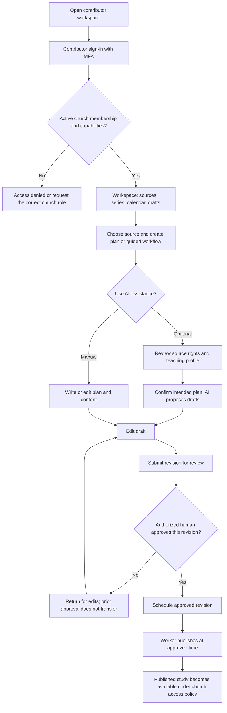
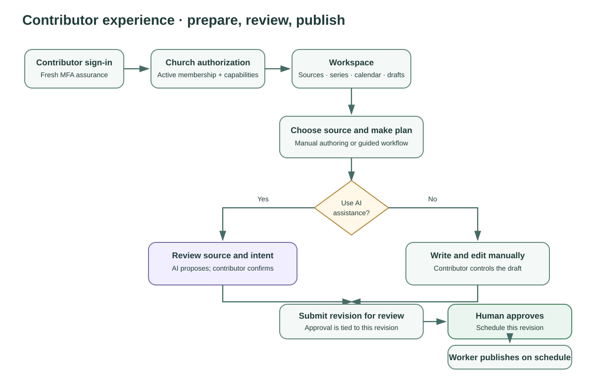

# Mental model 2 — contributor experience

Contributors enter the church workspace through a privileged sign-in flow. The identity provider must satisfy MFA for a fresh contributor session, and the application then checks the person's active church membership and specific capabilities. MFA alone does not grant a role.

From the workspace, a contributor can manage sources and series, prepare a study plan, edit content, request review, approve a revision, and schedule an approved publication. The guided co-writer is an optional assistive workflow: it works from a reviewed source or explicitly reviewed conversation notes, asks for confirmation, and saves proposals as drafts. Human review, approval, and scheduling remain distinct steps. A changed source, plan, or content revision can invalidate dependent review or scheduling state.

## Journey

## Review and publication rules

- Capabilities are checked per church and per operation; contributor access is not a global administrator grant.
- AI output is a draft or proposal. It does not approve, schedule, or publish itself.
- Plan review and content approval are separate; scheduling binds to the approved content revision.
- Edits after approval can invalidate the dependent approval/schedule. A timezone update does not silently move an already approved publication date.
- The continuous worker handles due publication/provider work and guided study workflow jobs. A one-off database migration job is operational setup, not a replacement for this worker.
- SMS, transcription, Planning Center, and other external providers are inactive unless separately configured and enabled.

## Implementation references

- [Workspace route](../../frontend/app/%5Broute%5D/page.tsx)
- [Workspace components](../../frontend/components/workspace.tsx)
- [Guided study co-writer](../../frontend/components/guided-study-cowriter.tsx)
- [Study workflow API](../../backend/src/api/study-workflow-routes.ts)
- [Study workflow module](../../backend/src/modules/study-workflows.ts)
- [Publication worker](../../backend/src/workers/worker.ts)

