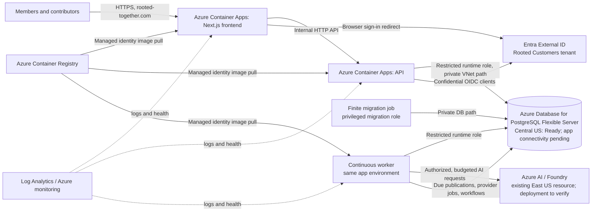
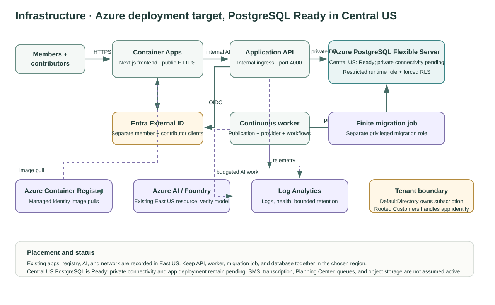

# Mental model 3 — infrastructure design

The intended deployment is a browser-facing Next.js frontend and an internal API in Azure Container Apps, with a continuously running worker in the same application environment. The API and worker share application logic and connect to managed PostgreSQL through a restricted runtime database account. Schema changes run separately through a finite migration job with privileged migration credentials.

Two confidential Entra External ID applications serve different entry points: member email-code sign-in and contributor sign-in with MFA for privileged actions. Both use the same customer tenant and application callback origin; the app binds identities by tenant/object ID rather than email. The DefaultDirectory owns the Azure subscription and deployment resources. Rooted Customers is the customer identity tenant, not the subscription's owner directory.

The original application, registry and AI resources are recorded in East US, with another prepared VNet in East US 2. Central US now hosts the Ready PostgreSQL 17.11/B1ms/32 GiB server, the new frontend and environment, and a running API. The private migration job completed with `Migrations applied`; frontend-to-API routing works; the API's readiness endpoint returns HTTP 200 with database connected, schema current and tenant isolation enforced. The continuous worker, main-domain binding, real identity/MFA and AI acceptance remain pending. Shared registry and AI resources remain in East US. See the [current deployment handoff](../Azure%20Deployment%20Research/path-b-resume-plan.md).

## System view

## Placement and trust boundaries

- **Azure subscription owner:** DefaultDirectory tenant `978d8f90-ec27-43a5-8f18-6436c5082916`. **Customer identity:** Rooted Customers tenant `84524f4e-0cf6-4701-b128-dae041d1c910`. The latter does not own the Azure subscription.
- **Existing East US footprint:** Container Apps environment/frontend, VNet, registry, AI resource/project, and Log Analytics workspace are recorded in the deployment handoff. Actual health/configuration should be confirmed in Portal before changes.
- **Database location:** Central US, confirmed Ready. Place the replacement app, API, worker and migration job in that region; network and application acceptance remain pending.
- **Networking:** intended PostgreSQL access is private VNet integration through the region-matched delegated PostgreSQL subnet and linked private DNS. The frontend is public HTTPS; API ingress is internal to its app environment; worker and migration job have no public ingress.
- **Database permissions:** API and worker use a non-owner runtime account subject to forced row-level security. The migration job alone uses separate privileged credentials. Never put either credential in images or documentation.
- **Identity:** member and contributor confidential clients are separate. The contributor path requires recent MFA for privileged assurance and the app still enforces church membership/capabilities. Tokens and secrets are not diagrammed or stored here.
- **Operations:** use managed identity for ACR image pulls; keep bounded logs/alerts and the existing resource-group budget in view. Backups and restore testing remain deployment acceptance work.
- **AI:** existing Azure AI resources are retained. A usable model deployment/endpoint and budget behavior still require verification before enabling live calls. AI assistance must not directly approve or publish content.

## What is not shown as a live dependency

The diagram omits SMS, transcription, Planning Center, a queue service, and object storage as required live components. Existing research proposals mention some of these, but they are not confirmed as active in the current Path B deployment. The continuous worker currently polls PostgreSQL-backed work and workflows. Do not add infrastructure solely because an older research diagram proposed it.

## Implementation and deployment references

- [Deployment resume plan](../Azure%20Deployment%20Research/path-b-resume-plan.md)
- [Azure sign-in configuration and acceptance](../../deploy/azure/access-based-login.md)
- [Frontend routing and API rewrite](../../frontend/next.config.ts)
- [Backend production configuration](../../backend/src/infrastructure/config.ts)
- [Database runtime](../../backend/src/infrastructure/database.ts)
- [Continuous worker](../../backend/src/workers/worker.ts)

