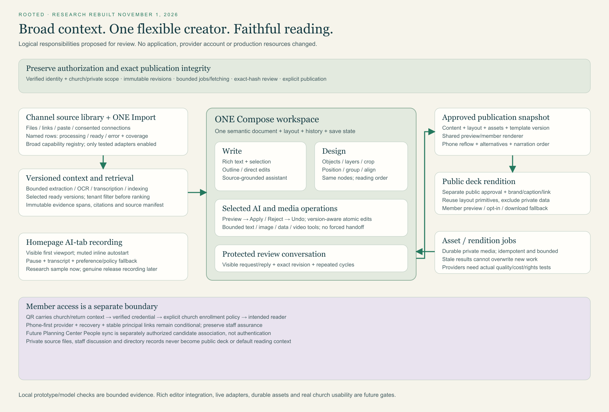

# Proposed architecture — one document, broad context, two editing views

**Research proposal, rebuilt November 1.** Logical boxes are responsibilities, not newly deployed services. See [technical feasibility](technical-feasibility.md) for actual source constraints, framework/licensing comparison, records, operation-model tests and provider gates.

Editable [SVG](product-architecture.svg) and [Mermaid](product-architecture.mmd) are regenerated. The earlier separate CoWriter/Studio diagram is superseded and archived.

## Main flow

Church channel source library → one Import with capability adapters → async processing and immutable source versions → scoped index/retrieval and selected-source manifest → **one Compose document** → exact review → immutable publication → shared member renderer.

Compose has Write and Design projections, a docked assistant and conversation. Semantic nodes, content order and layout live in one document. Text/image/data/video tools may use specialist jobs, policies and budgets without making contributors complete separate creation stages.

| Responsibility | Proposed addition | Invariant |
|---|---|---|
| Channel sources | Source metadata, versioned blobs/spans, batch import, adapter registry, readiness/coverage | Named rows survive processing; only authorized ready versions become context |
| Retrieval | Tenant/private filtering, index/chunks, citations and selected-version manifest | Filter before ranking; never silently ingest every complete file |
| Unified authoring | Semantic rich document, layout/artboards, selection, atomic operations and history | One draft/version; visual layer order differs from explicit reading order |
| Media jobs | Scanning/OCR/transcription/rendering/generation candidates | Bounded, idempotent jobs; late/stale outputs cannot overwrite or approve |
| Review | Protected event history, passage/node anchors and repeated cycles | Actor/time/hash remain visible; replies do not imply resolution |
| Publication | Immutable content/layout/asset/template snapshot and shared renderer | Preview and phone/accessibility reading agree on approved meaning/order |
| Public decks | Exact public-rendition approval, brand/caption/destination | Source/private-study access never expands implicitly |
| Member access | Stable principal, verified credentials, church policy and return context | QR/phone/name/People matching are not staff authority |

## Preserve and extend

Keep verified OIDC/church authorization, exact-hash review and publication, defended bounded network fetching, revision history, job accounting and private tenancy. Extend schemas deliberately with a legacy adapter; do not hide new JSON inside text or reinterpret old approval hashes.

Cloud connectors require explicit scope/consent/revocation. NotebookLM Enterprise preview APIs are a conditional alternative, not an assumed dependency. The homepage recording uses a public media route and contains no visitor AI call. It autostarts muted only while active/visible with pause and preference/policy fallback.

Member identity/enrollment and People sync stay separate from content ingestion. Directory records are not default source context. Public decks and member reader have different audience/access boundaries.

## Proof still required

The new local model tests validate selected state/operation invariants; the prototype validates bounded UI behavior. Neither establishes integrated rich-editor behavior, production parsers, durable assets or live providers. Before release prove source → same-document edit/design → save → review → publish → identical member reading, plus independently approved public exports and verified church enrollment.
