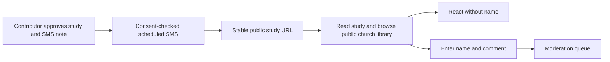

# Option B: public study links and account-free participation

Research snapshot: **2026-11-04**. This is an architecture proposal, not a deployed feature. It is the alternative to [Option A's verified-phone member access](option-a-phone-verified.md). The goal is that a person who receives a study text can tap once, read the study and browse the church's available studies without creating an account or signing in. A reader supplies a name only when leaving a comment; reactions require neither sign-in nor a name. The [detailed migration plan](option-b-migration-plan.md) resolves the data and release sequence for implementation.

## The proposed reader experience

1. A contributor approves a study and writes a short delivery note. Rooted shows the *exact* SMS preview: church name, contributor's note, study title, stable study link and required opt-out wording. Existing review and publishing controls remain in force.
2. At the approved delivery time, Twilio sends the text only to contacts with recorded SMS consent. Example: **RiverFront Church: A new study from Pastor Jordan — “Keep Sowing When You Cannot See.” Read it here: https://rooted-together.com/c/riverfront/studies/… Reply STOP to opt out.** The creator can edit the note; Rooted supplies the verified church/study link and required delivery text.
3. Tapping opens the study immediately. The church page shows that study and a clear **All available studies** path. The same link works when shared with anyone, including someone who never received an SMS. No entry token, phone check, account, or expiry is required.
4. The reader can react with one tap. To comment, they enter a display name and comment text. The interface says the name is **provided by the commenter, not verified**. A submitted comment waits for church moderation before appearing publicly.

The link is a **public address, not an authentication credential**. Anyone who obtains it may read and share it. “At any time” means the link has no routine login or token expiry; the church may still withdraw or unpublish a study, and the page must then show a clear unavailable state. If the product also exposes the church's public library, assume the studies can be discovered beyond the original SMS audience. An optional `noindex` setting may reduce search appearance, but it does not restrict access and must never be described as privacy. [Google Search Central's `noindex` documentation](https://developers.google.com/search/docs/crawling-indexing/block-indexing).

## What exists today and what must change

| Area | Current Rooted behavior | Option B change |
| --- | --- | --- |
| Published reading | Public read APIs already exist at `/v1/public/churches/:slug/studies` and `/:id`, and [the server route](../../backend/src/api/core-routes.ts) returns only live, nonwithdrawn publications. Church settings include `readingPolicy: members | public`; new churches default to `members`. | Make public reading the required mode for this experience. Remove member-only reading gates and sign-in prompts from the church study pages. Keep draft, withdrawn, historic and unpublished content unavailable through public APIs. Decide whether the public library lists all live studies or a narrower editorial collection; this proposal assumes all live studies. |
| Reactions | [The reaction endpoint](../../backend/src/api/core-routes.ts) uses `member.userId`; the schema binds reactions to membership. | Add an anonymous reaction endpoint and storage. One reaction selection per study per anonymous browser identifier, with server-side rate limits and moderation controls. Do not claim one per human being. |
| Comments | [Community routes](../../backend/src/api/community-routes.ts) require member identity and join `memberships` for author names. | Add public comment submission with required name and text, server-side validation, pending moderation, safe rendering, and an abuse-report path. Staff replies remain authenticated and attributed. |
| SMS recipients | [`provider_contacts`](../../backend/migrations/002_providers.sql) requires a membership `user_id`, although phone storage, consent events, suppression and send intents already exist. | Move delivery contacts to a church-scoped **recipient** model independent of application accounts. Retain encrypted phone storage, consent history, STOP suppression, sender scope, delivery audit and recipient time zone. |
| SMS content | [Provider routes](../../backend/src/api/provider-routes.ts) use an approved outbound preview and send intent with consent/version checks. | Add contributor-authored delivery note and stable study URL to the exact preview. Freeze the approved message version; editing the note or link invalidates approval and requires renewed review. No per-recipient login token is needed. |
| Staff security | Entra-based contributor/admin sign-in and capabilities guard creation, approval, scheduling, moderation and settings. | Keep staff sign-in, MFA and authorization. Removing *reader* accounts must not make staff routes public. |

Setting `readingPolicy` to `public` alone is **not** a complete implementation: engagement, recipient contacts, member prompts, analytics and moderation still assume a signed-in member. It may expose already published studies immediately, so switch it only as part of a deliberate content review and rollout.

## Data and API design

- Introduce `recipients` (or migrate `provider_contacts`) keyed by church and contact ID, with encrypted E.164 phone, tenant/sender-scoped deduplication hash, time zone and provenance (`admin`, `Planning Center People`, or self-enrollment). Preserve consent as separate versioned events. Remove the mandatory membership foreign key only after old jobs and UI have been migrated. Admin entry or Planning Center import is a candidate contact, **not** proof of SMS opt-in. Planning Center People import is not implemented today; verify API permissions, phone fields and church mapping before building it. [Planning Center developer documentation](https://developer.planning.center/docs/).
- Add a publication-bound SMS note/version. Generate the canonical URL on the server from the church slug and publication ID, not from arbitrary contributor-supplied URLs. Preview the actual composed message and estimated segments before approval. On a superseded or withdrawn publication, suppress unsent intents and show an unavailable page for old links; decide whether to redirect to the replacement only when the church explicitly chooses that behavior.
- Store anonymous reactions separately from member reactions, or migrate to a shared reaction table with nullable actor type and clear uniqueness constraints. Give the browser a random first-party identifier in a `Secure`, `HttpOnly`, `SameSite=Lax` cookie, with a defined rotation/retention period. This is a convenience for updating a reaction, **not proof of identity**. Apply per-identifier and coarse IP/network rate limits; do not use reaction counts as unique-person counts. Visitors who clear cookies or change devices can react again. Avoid fingerprinting.
- Store public comments with `display_name`, body, publication/church IDs, status, timestamps and a moderation trail. Names are self-asserted and may be duplicated or impersonated. Validate length and content, render as text, and default to pending review. If a visitor should later edit/delete their own comment, issue a separate limited receipt token; otherwise offer a removal request path. Staff replies and moderation decisions retain authenticated actor IDs. Existing member discussions and reports need a migration/archival policy because [`discussions` and `reports`](../../backend/migrations/001_core.sql) currently require member IDs.
- Add public **read**, **react**, **comment**, and **report** endpoints scoped to a live publication and church. Public write endpoints need origin/CSRF protection appropriate to cookie use, request size limits, rate limits and automated-abuse controls. Do not expose unpublished metadata, staff notes, consent details, phone numbers, or recipient IDs. Make public analytics aggregate; today's `study_opens` table is user-linked and cannot measure unique people in this model.
- Remove the reader sign-in prompts and member account flow from the public church page. Keep a distinct protected staff workspace. Define migration/retention for existing reader accounts, sessions, membership-linked engagement and historical delivery records; preserve staff memberships and legal/audit records according to retention policy.

## Twilio and deployment requirements

This option **removes phone verification for reading, not SMS consent**. Continue to collect and retain recipient-specific opt-in evidence for the sender and use case; honor STOP and suppression before each send. A Planning Center phone field or church roster alone does not establish messaging consent. US A2P 10DLC brand/campaign registration and approved sample/opt-in flows may apply to the sending route; verify the actual Twilio sender and jurisdiction during implementation. [Twilio Messaging Policy](https://www.twilio.com/en-us/legal/messaging-policy), [A2P 10DLC overview](https://www.twilio.com/docs/messaging/compliance/a2p-10dlc), [Messaging Services opt-out handling](https://www.twilio.com/docs/messaging/services).

For the owner-facing sequence and materials to prepare, see [Option B: what you need to do for Twilio](option-b-twilio-setup.md).

Deploy new backend, worker and frontend images plus database migrations together. Existing Azure Container Apps and Postgres can support the shape; no Twilio Verify service or SMS-login token service is required. Add public API ingress for reading/engagement, but keep staff APIs, Twilio secrets and worker operations protected. Confirm CDN/proxy caching cannot serve a withdrawn study indefinitely; use appropriate cache invalidation and avoid caching personalized moderation responses. Roll out behind church-level flags, migrate contact data, run backfill checks, then turn on public reading and anonymous engagement for a pilot church. [Current Azure deployment process](../../deploy/azure/ci-cd-process.md).

## Path from current state

1. **Content and policy decision:** Church owners review whether every live study is suitable for anyone to see, including copyrighted sermon excerpts, personal examples and comments. Choose public library scope and withdrawal behavior. This is the main decision gate before exposure.
2. **Recipient migration:** Separate SMS contacts from member accounts; retain consent and suppression history. Build admin contact entry and, later, a separately authorized Planning Center People import. Test duplicate numbers, shared phones, revocation and STOP.
3. **Public reader:** Use the existing public study API as the base. Update frontend routes, library navigation and unavailable states. Verify anonymous readers cannot fetch drafts or withdrawn publications.
4. **Anonymous engagement:** Implement reaction and named-comment APIs, moderation/reporting, rate limits and staff dashboards. Label names as unverified. Replace member-based engagement metrics with aggregate counts.
5. **Delivery:** Add creator note, server-generated stable URL, exact SMS preview, renewed approval on edits and scheduled sends. Exercise Twilio callback, failed delivery, opt-out and old-link scenarios.
6. **Controlled release:** Run migration and API compatibility checks, deploy backend/worker/frontend revisions, enable a pilot church, then expand after moderation and abuse review. Keep rollback able to disable anonymous writes quickly; closing public reading may require a separate content decision because links will already have been shared.

## Acceptance checks and tradeoffs

The launch is ready when an unregistered person can open a fresh SMS link and a forwarded link on another device without sign-in; see the exact published study and public library; react without entering a name; submit a comment only after entering a name; and see a pending-review confirmation. A church moderator can approve/hide/report comments and remove abusive reactions. STOP blocks future sends, withdrawn studies no longer render, and public endpoints cannot expose drafts, phones or staff data.

The chief benefit is the simplest reading path and the easiest sharing. The cost is that study content and approved comments are public, commenter names are unverified, and reaction/open counts cannot reliably represent unique church members. Public comment endpoints require more moderation capacity and abuse controls. Option A is preferable when the church needs restricted content or member-level engagement history; see the [recipient mental-model comparison](member-mental-model-comparison.md).
